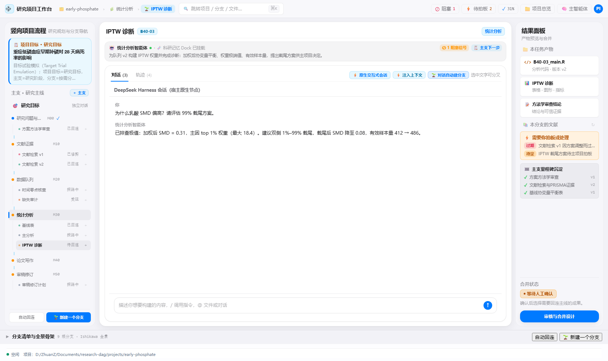
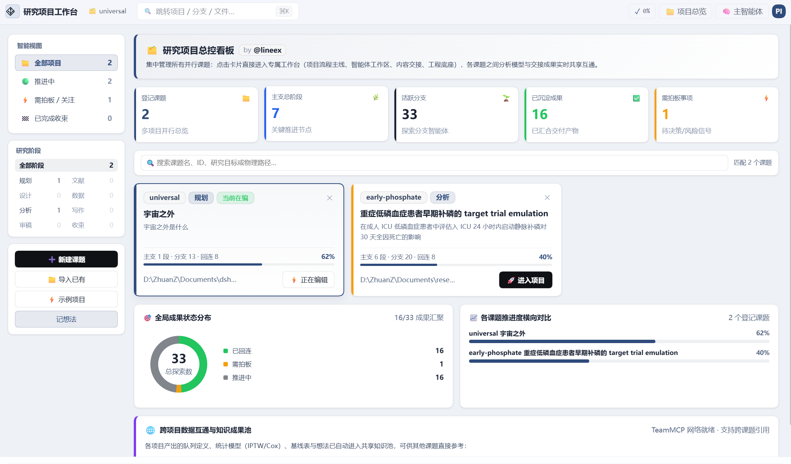

<p align="center">
  
</p>

<h1 align="center">研究项目工作台 (dsh-research-workbench)</h1>

<p align="center">
  <strong>面向科学研究与复杂课题的「项目流程式」探索智能体协同研创工作台</strong><br>
  项目总目标 = 研究核心问题 · 主支 = 严密研究阶段 · 分支 = 任意节点长出的自主探索智能体 · 成果满意后一键回连
</p>

<p align="center">
  <a href="package.json"></a>
  <a href="https://github.com/lineex/dsh-research-workbench"></a>
  <a href="CONTRACT.md"></a>
  <a href="LICENSE"></a>
  
</p>

---

## 📖 目录 (Table of Contents)

- [💡 项目愿景与设计哲学](#-项目愿景与设计哲学)
- [🖥️ 产品全景真实图景](#️-产品全景真实图景)
  - [三栏沉浸式科研舞台全景](#1-三栏沉浸式科研舞台全景-workbench-stage)
  - [课题群多项目总控看板](#2-课题群多项目总控看板-projects-hub)
- [🌟 核心功能体系](#-核心功能体系)
  - [1. 递归上下文继承协议](#1-递归上下文继承协议-recursive-context-inheritance)
  - [2. 独立会话秒切与零串扰隔离](#2-独立会话秒切与零串扰隔离-zero-cross-talk-sessions)
  - [3. 研究目标「第 0 主支」与八层假设审计](#3-研究目标第-0-主支与八层假设审计-g-r-e-d-m-o-t-w)
  - [4. 一键生成标准科研流水线与完整修改权](#4-一键生成标准科研流水线与完整修改权-pipeline-scaffolding)
  - [5. Zotero 本地文献库无缝穿透](#5-zotero-本地文献库无缝穿透-zotero-integration)
  - [6. 总控台课题回收站与防误触保护](#6-总控台课题回收站与防误触保护-project-recycle-bin)
- [🔬 科研实战典型工作流](#-科研实战典型工作流)
- [🛠️ 工程结构与代码架构](#️-工程结构与代码架构)
- [🚀 快速上手与验证](#-快速上手与验证)
  - [安装到 DSH Desktop](#1-安装到-dsh-desktop)
  - [本地构建与全量门禁自检](#2-本地构建与全量门禁自检)
- [📖 核心接口与协议速查](#-核心接口与协议速查)
- [🤝 贡献与开源许可](#-贡献与开源许可)

---

## 💡 项目愿景与设计哲学

在现代生物医学、临床流行病学、因果推断以及复杂科学研究中，研究者常常面临一个巨大的矛盾：**AI 对话模型具备强大的单点推理能力，但在长周期的真实科研课题中，传统的“单窗口长对话”极易崩溃。**

传统的通用 AI 聊天界面在科研深度探索中存在四大致命痛点：
1. **线性上下文遗忘与污染**：讨论完第 4 阶段的倾向评分统计分析后，再回头调整第 1 阶段的研究方案，整个对话上下文迅速超出 Token 上限，互相覆盖与幻觉频发；
2. **分支探索难以收敛**：科学探索本质是“假设 $\to$ 试错 $\to$ 证伪 $\to$ 剪枝”，单线对话无法支持长出多条平行测试支线，更无法将优质分支成果干净回连到主线；
3. **立项缺乏假设审计**：研究者容易在未充分推敲的前提下匆忙开工，缺乏对核心因果假设、时空参照系和可推翻条件的严密审查；
4. **文献管理与研究脱节**：市面上的 AI 工具无法穿透本地文献管理器，无法在探讨具体分析步骤时精准引用真实文献题录与合集。

**`dsh-research-workbench` 正是为此而生。**

本工作台深度融合 **DAG（有向无环图）课题流程引擎** 与 **Ishikawa 鱼骨研创结构**，在 DeepSeek Harness 架构上构建起一套严谨的科研操作系统：
- **项目总目标**：定义课题核心要回答的研究问题与可证伪推翻条件；
- **主支（Modules）**：严格定义研究推進的关键阶段（如方案制定、文献检索、队列提取、统计建模、手稿起草）；
- **分支（Branches）**：在任意主支节点按需分化出的探索/修正智能体，具备自主专属对话环境与定向任务；
- **严格递归继承**：每个分支自动承袭“前序主支全部成稿 + 本主支成稿 + 祖先分支历史”，杜绝偷看后序主支或串台；
- **一键回连（Graft）**：当分支智能体探索出的代码、图表与审查结论令研究者满意时，一键触发合并写入阶段交付物，主线稳步向前推进。

---

## 🖥️ 产品全景真实图景

### 1. 三栏沉浸式科研舞台全景 (Workbench Stage)

工作台采用现代专业科研工作站设计语言：**业务整页沉浸** (`customFrame: true`) + **紧凑顶栏** (`headerLayout: 'compact'`) + **三栏并列舞台** + **可收纳全景骨架抽屉**。

<p align="center">
  
</p>

```text
┌──────────────────────────────────────────────────────────────────────────────────────────────────────────┐
│ ❖ 研究项目工作台  📁 early-phosphate  › 统计分析 › IPTW诊断  🔍 ⌘K        [✓ 31%]  [📁 项目总览] [🧠 主智能体] [PI] │
├──────────────────────────────────────────────────────────────────────────────────────────────────────────┤
│                                       三 栏 沉 浸 式 研 究 舞 台                                           │
│ ┌──────────────────────────┬────────────────────────────────────────────┬──────────────────────────────┐ │
│ │ 🎯 项目目标 · 研究总目标 │ 📌 当前任务工作区 (Main Stage)             │ 📚 本分支的文献 (Zotero)     │ │
│ │ 重症低磷血症患者早期补磷 │ ────────────────────────────────────────── │ ──────────────────────────── │ │
│ │ target trial emulation   │ 📍 派生原点: 主支 M20 检索式 (Message #42) │ 🔍 搜索本地 Zotero 文库...   │ │
│ │ ──────────────────────── │ 📄 挂载档案: CONTEXT.md (递归继承链快照)   │ ──────────────────────────── │ │
│ │ 主支 · 研究主线    + 主支│ ────────────────────────────────────────── │ • Hernán 2016 (Target Trial) │ │
│ │                          │                                            │   DOI: 10.1016/j.jclinepi... │ │
│ │ 🎯 研究目标     独立对话 │           嵌入式原生 AI 探索对话           │ • Wang 2023 (ICU Phosphate)  │ │
│ │ │                        │   ┌────────────────────────────────────┐   │ • Suzuki 2019 (Hypophos RCT) │ │
│ │ 🌿 M10 方案设计与协议    │   │ 🤖 AI 智能体:                      │   │ ──────────────────────────── │ │
│ │ │  └─ B10-01 协议制定[成]│   │ 已读取前序主支全部成稿与祖先分支   │   │ 📁 导入合集: 补磷队列与RCT   │ │
│ │ │                        │   │ 结果。正按目标试验模拟方案推进...  │   │ ──────────────────────────── │ │
│ │ 🌿 M20 文献检索与证据    │   │                                    │   │ ⚡ 需拍板事项 (Attention)    │ │
│ │ │  ├─ 22 检索式构建  [成]│   │ 👤 研究员:                         │   │ ⚠️ IPTW 截尾方案待主项目拍板 │ │
│ │ │  └─ B20-03 系统检索    │   │ 请核查第 24 小时入组的时间零点定义 │   │                              │ │
│ │ │                        │   └────────────────────────────────────┘   │ ✅ 已沉淀交付物 (Accepted)   │ │
│ │ 🌿 M30 队列定义与提取    │ ┌────────────────────────────────────────┐ │ • cohort_definition_v2.md    │ │
│ │ │  ├─ B30-01 协变量平衡  │ │ 输入指令 / 与当前分支智能体讨论...     │ │ • table1_baseline.csv        │ │
│ │ │  └─ B30-02 倾向评分    │ └────────────────────────────────────────┘ │ • iptw_diagnostics_report.md │ │
│ └──────────────────────────┴────────────────────────────────────────────┴──────────────────────────────┘ │
├──────────────────────────────────────────────────────────────────────────────────────────────────────────┤
│ ▼ 全景鱼骨图与跨主支分支看板 (Bottom Drawer)                       [自动回连满意分支]   [🌱 新建一个分支] │
└──────────────────────────────────────────────────────────────────────────────────────────────────────────┘
```

- **顶栏控制集群**：全新的 **DAG Nexus 品牌星芒徽标**、当前课题面包屑导航、`⌘K` 全局检索、完成度进度、**`[ 📁 项目总览 ]` 一键回退按钮**与 PI 主研究者身份卡；
- **左栏（流程与骨架）**：常驻顶层的「🎯 研究目标 独立对话」（第 0 主支）、严谨的主支推进链及分支展开折叠树；
- **中栏（任务舞台）**：前置上下文与派生原点快照、嵌入式原生会话流，支持与当前分支智能体展开深度攻关；
- **右栏（交付与证据）**：本分支挂载的 Zotero 文献库、需要拍板的决策项、各阶段已验收的成稿与交付物；
- **底栏（骨架全景）**：一键展开查看 Ishikawa 全流程鱼骨图，掌控课题整体拓扑。

---

### 2. 课题群多项目总控看板 (Projects Hub)

多课题并行研发指挥控制台：支持大号核心科研指标统计卡片、智能视图过滤、课题卡片墙与总控台回收站。

<p align="center">
  
</p>

```text
┌──────────────────────────────────────────────────────────────────────────────────────────────────────────┐
│ 📁 课题群总控看板 (Projects Hub)                                                + 新建项目 (📁 本地文件夹)│
├──────────────────────────┬───────────────────────────────────────────────────────────────────────────────┤
│ 智能分类导航             │ 📊 全局核心科研指标 (KPIs)                                                    │
│ • 全部项目           (6) │ ┌───────────┐ ┌───────────┐ ┌───────────┐ ┌───────────┐ ┌───────────┐         │
│ • 推进中             (4) │ │ 📁 6      │ │ 🌿 36     │ │ 🌱 52     │ │ ✅ 24     │ │ ⚡ 2      │         │
│ • 需拍板 / 关注      (2) │ │ 登记课题  │ │ 主支阶段  │ │ 活跃分支  │ │ 沉淀产物  │ │ 风险拍板  │         │
│ • 已完成收束         (1) │ └───────────┘ └───────────┘ └───────────┘ └───────────┘ └───────────┘         │
│ • 🗑️ 回收站          (1) │ ───────────────────────────────────────────────────────────────────────────── │
│ ──────────────────────── │ 🔍 搜索项目标题、ID、研究目标、绝对路径...                                    │
│ 阶段过滤                 │ ───────────────────────────────────────────────────────────────────────────── │
│ 🔘 全部阶段              │ ┌──────────────────────────┐ ┌──────────────────────────┐ ┌─────────────────┐ │
│ ⚪ 方案设计 (M10)        │ │ 🟢 重症低磷血症早期补磷  │ │ 🟢 CRRT 启动时机分析   │ │ 🏁 脓毒症抗凝 │ │
│ ⚪ 文献检索 (M20)        │ │ 阶段: 统计分析 · 62%     │ │ 阶段: 数据清洗 · 40%   │ │ 已收束 · 100% │ │
│ ⚪ 队列提取 (M30)        │ │ 6 主支 · 9 分支 · 1 拍板 │ │ 5 主支 · 6 分支 · 1 拍板 │ │ 成果汇编已落定│ │
│ ⚪ 统计分析 (M40)        │ └──────────────────────────┘ └──────────────────────────┘ └─────────────────┘ │
│ ⚪ 论文撰写 (M50)        │                                                                               │
└──────────────────────────┴───────────────────────────────────────────────────────────────────────────────┘
```

---

## 🌟 核心功能体系

### 1. 递归上下文继承协议 (Recursive Context Inheritance)
每一个分支智能体在启动或对话注入时，系统会自动为其编译生成不可篡改的四级上下文继承快照：
1. **前序主支全部成稿**：严格按照时间序列由前向后整合前序阶段的交付物（如方案设计、入排队列），绝不逆向偷看后序主支；
2. **本主支已有成稿**：本阶段内已达成共识的基准产物；
3. **祖先分支链**：追溯从父分支到子分支的派生原点与讨论记录；
4. **本分支专属任务**：写入 `CONTEXT.md` 快照与任务简报（`BRIEF.md`），使智能体一开工即精准掌握背景。

### 2. 独立会话秒切与零串扰隔离 (Zero-Cross-Talk Sessions)
- **点哪切哪，历史自持**：点击左侧任意主支、分支或研究目标，中央舞台立即呈现该节点独立的会话历史，**不同任务节点之间零串扰、零上下文污染**；
- **智能生命周期状态机**：
  - 已有会话：毫秒级切回并完整恢复对话与产物预览；
  - 新建分支：自动生成绑定的独立会话并在首次交互时将四级继承链自动填入对话框。

### 3. 研究目标「第 0 主支」与八层假设审计 (G-R-E-D-M-O-T-W)
- **目标常驻**：将课题总目标提升为「第 0 个主支」，点击即可进入目标探讨专属智能体会话；
- **内置 ZhuanZ 个人思考框架**：一键注入八层假设审计脚手架：
  - $G$ (几何维度) $\to$ $R$ (参照系) $\to$ $E$ (端点动力学) $\to$ $D$ (端点结构) $\to$ $M$ (默认态) $\to$ $O$ (度量方式) $\to$ $T$ (导数阶与时间角色) $\to$ $W$ (观察窗口)；
- **可证伪好问题卡 (good-question)**：引导研究者明确界定“什么观测结果会彻底推翻当前假设”，收敛出坚实可靠的立项基石。

### 4. 一键生成标准科研流水线与完整修改权 (Pipeline Scaffolding)
- **会话内生成阶段架构**：探讨收敛好问题后，AI 可直接给出包含 3–6 个严密推进阶段（如方案、检索、队列、建模、汇编）与初始探路分支的架构蓝图；
- **一键铺设流水线**：在中栏点击 **`[ 🌱 一键生成主支与分支规划 ]`**，系统自动秒级在本地创建标准 5 阶段主支与对应探路分支；
- **PI 拥有全部修改权限**：
  - 主支可随时自由重命名、上移/下移调整研究先后顺序、收起或新增；
  - 分支可随时重命名、上下重排、标记阻塞/解阻、分出二级子分支、移入回收站或彻底删除；
  - 成果满意后一键回连（Graft），自动落盘为阶段成稿并备份历史快照。

### 5. Zotero 本地文献库无缝穿透 (Zotero Integration)
- **只读本地 API 直通**：对接本机运行的 Zotero（默认端口 `127.0.0.1:23119`），无需联网即可毫秒级调取；
- **分支条目挂载**：支持在右侧面板直接搜索本地文献并一键挂载到当前分支，使分支探索随时具备真实参考文献依据；
- **合集（Collection）批量导入**：支持将整套 Zotero 合集挂载到阶段中，自动关联文献标题、作者、年份与 DOI。

### 6. 总控台课题回收站与防误触保护 (Project Recycle Bin)
- **删除二次确认防误触**：在 Projects Hub 点击课题卡片右上角的 `✕` 时，系统弹出微质感确认弹窗，明确告知本地磁盘文件完整保留，避免研究者手滑误删；
- **独立的课题回收站**：被移除的课题进入左侧「🗑️ 回收站」分类；
- **一键还原与彻底清除**：在回收站中可随时点击 **`[ ↩ 还原 ]`** 将课题无损恢复至主看板；若确认废弃，可点击 **`[ 彻底清除 ]`** 永久移除记录（本地物理文件夹始终安全保留）。

---

## 🔬 科研实战典型工作流

```text
[ 1. 新建课题 ]  → 打开 Projects Hub，直选本地文件夹建立课题骨架
       ↓
[ 2. 目标审计 ]  → 点击「🎯 研究目标 独立对话」，运行八层审计收敛 good-question
       ↓
[ 3. 规划主支 ]  → 一键生成 5 大标准推进主支流水线（方案→检索→队列→建模→成稿）
       ↓
[ 4. 分支探索 ]  → 各主支长出分支智能体，读取前序成稿并挂载 Zotero 本地文献
       ↓
[ 5. 成果回连 ]  → 探索产出满意的分析代码/表格/结论，点击「自动回连」沉淀主线
```

---

## 🛠️ 工程结构与代码架构

```text
dsh-research-workbench/
├── package.json               # 插件契约元数据 (dsh-research-workbench v3.10.0)
├── cordis.patch.yml           # DSH 插件服务树声明文件
├── icon.svg                   # DAG Nexus 品牌矢量图标 (官方徽标)
├── CONTRACT.md                # 协议实现契约规范文档
├── DESIGN-workbench.md        # 深度架构设计白皮书与避坑实录
├── lib/
│   ├── host.js                # 宿主后端：HTTP 接口路由、安全子进程、会话绑定管理
│   └── client.js              # 客户端生产 bundle (装配 33 个组件模块的纯单文件)
├── src/                       # 模块化纯源码
│   ├── WorkbenchPanel.js      # 顶层工作台面板容器、全局状态协调与弹窗系统
│   ├── index.js               # DSH 客户端插件入口与错误边界
│   ├── components/            # CommandBar 命令栏、ReasonDialog 等核心 UI
│   ├── views/                 # 舞台视图：FishboneView、ProjectsHubView 等
│   └── core/                  # 常量、主题令牌、API 通讯与好问题提示词体系
├── tools/
│   ├── build-client.mjs       # 高性能模块装配编译脚本
│   └── render-real.mjs        # 视觉验收与无头浏览器真实组件渲染工具
└── verify/                    # 严密的 10 套自动化验收断言体系 (159 项检查全绿)
```

---

## 🚀 快速上手与验证

### 1. 安装到 DSH Desktop

#### 方式 A：通过 DSH 插件市场安装（推荐）
在 DSH Desktop 的「工作台 / 插件市场」中搜索 **`dsh-research-workbench`** 或 **`研究项目工作台`**，点击安装即可。

#### 方式 B：本地离线包导入安装
```bash
# 1. 在本仓库根目录下打包
npm pack

# 输出: dsh-research-workbench-3.10.0.tgz
```
在 DSH Desktop 设置中选择安装本地工作台 `.tgz` 包，安装完成后**完全退出并重启 DSH Desktop** 即可生效。

---

### 2. 本地构建与全量门禁自检

本工程内置了覆盖宿主契约、组件渲染、生命周期与布局的 10 套严密自动化验收门禁：

```bash
# 1. 安装依赖（无额外三方运行时依赖，秒级完成）
pnpm install

# 2. 重新编译装配前端 bundle
node tools/build-client.mjs

# 3. 运行全量 10 套自动化验收门禁 (159 项用例断言)
npm run verify
```

门禁测试包含：
- `verify-host`: 宿主 HTTP 路由契约、会话持久化与 CLI 安全白名单校验；
- `verify-client`: 浏览器前端组件契约、数据流与轻量渲染校验；
- `verify-layout`: 三栏舞台网格、响应式断点与无多余侧栏布局校验；
- `verify-kit-root`: 模拟生产环境路径解析与工具包寻址校验；
- `verify-new-project-flow`: 全新空项目立项、加主支、分分支、挂载与落盘全链路校验。

---

## 📖 核心接口与协议速查

宿主服务默认在 `/research-workbench` 前缀下提供标准 HTTP 接口（并兼容 `/research-dag-workbench`）：

| 接口路径 | 请求方法 | 功能说明 |
|---|---|---|
| `/health` | `GET` | 检查工作台健康状态、动作白名单、CLI 根路径与 Zotero 状态 |
| `/fishbone` | `GET` | **核心全景协议**：读取当前项目的完整主支阶段、分支树、关注事项与进度 |
| `/session-get` | `POST` | 查询指定节点（主支 / 分支 / 研究目标）绑定的独立会话 ID |
| `/session-bind` | `POST` | 将会话 ID 持久化绑定到指定节点（支持 `branch:<mod>/<id>` 复合键） |
| `/goal-card` | `GET/POST` | 读取与保存好问题卡（八层假设审计与可证伪条件），回写总目标 |
| `/branch-work` | `GET` | 读取单个分支的上下文快照、历史指令与产物文件清单 |
| `/zotero` | `GET` | 实时检索本地 Zotero 题录与合集列表 |
| `/zotero-op` | `POST` | 对指定分支挂载或移除 Zotero 引用文献条目 |
| `/run` | `POST` | 触发 CLI 白名单科研任务（`init` / `module-add` / `sprout` / `graft` 等） |

---

## 🤝 贡献与开源许可

- **代码仓库**: [https://github.com/lineex/dsh-research-workbench](https://github.com/lineex/dsh-research-workbench)
- **架构设计白皮书**: 深入了解设计哲学请参阅 [`DESIGN-workbench.md`](DESIGN-workbench.md)
- **协议实现契约**: 详见 [`CONTRACT.md`](CONTRACT.md)
- **开源许可证**: 本项目采用 [MIT License](LICENSE) 开源。欢迎全球医学、自然科学与社科研究者共同完善！
