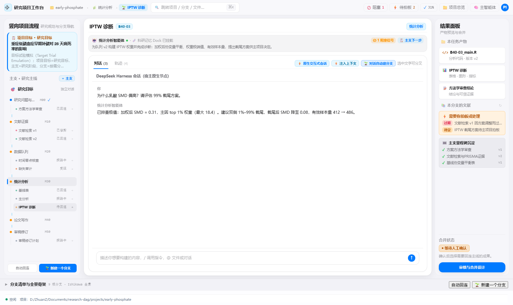
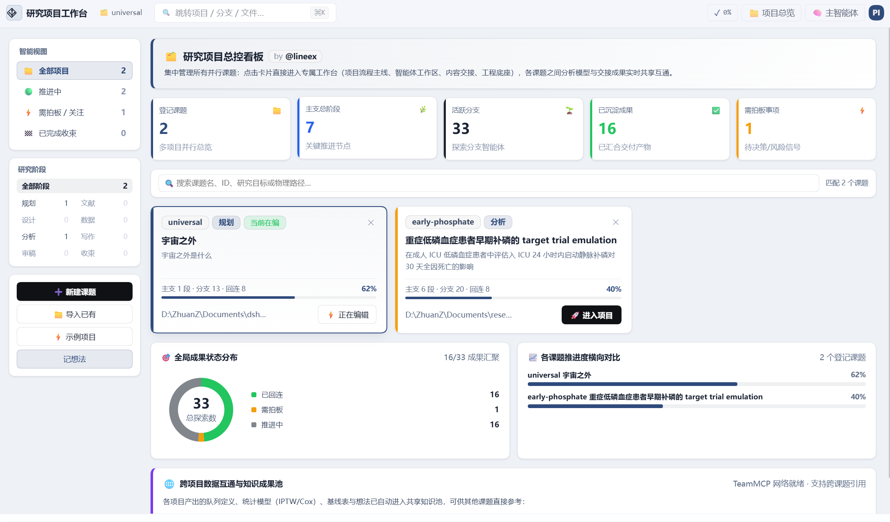

<p align="center">
  
</p>

<h1 align="center">Research Workbench (dsh-research-workbench)</h1>

<p align="center">
  <strong>A "Process-Flow" Autonomous Agent Orchestrator for Scientific Research and Complex Investigations</strong><br>
  Goal = Research Objective · Modules = Research Stages · Branches = Autonomous Exploration Agents · Merge-back on Success
</p>

<p align="center">
  <a href="package.json"></a>
  <a href="https://github.com/lineex/dsh-research-workbench"></a>
  <a href="CONTRACT.md"></a>
  <a href="LICENSE"></a>
  
</p>

---

[中文文档 (Chinese Documentation)](README.md)

[中文文档 (Chinese Documentation)](README.md)

## 💡 Vision & Design Philosophy

In modern biomedical, clinical epidemiological, causal inference, and complex scientific research, researchers often face a dilemma: **AI models have powerful inference capabilities, but traditional "single-window" chat interfaces collapse under the weight of long-term, multi-stage research projects.**

Conventional AI interfaces struggle with four critical pain points in deep research:
1. **Context Pollution**: Context windows get clogged and hallucinations arise when switching between stages (e.g., from literature review to statistical modeling).
2. **Hard-to-Converge Exploration**: Scientific discovery is iterative ("Hypothesis $\to$ Test $\to$ Falsify $\to$ Prune"). Single-line chat cannot support parallel testing branches.
3. **Lack of Hypothesis Audit**: Projects start without rigorous scrutiny of causal assumptions and falsifiable conditions.
4. **Disconnected Literature Management**: AI tools cannot seamlessly interface with local reference managers to cite papers within specific analytic steps.

**`dsh-research-workbench` is designed to solve these.**

It integrates a **DAG (Directed Acyclic Graph) workflow engine** and an **Ishikawa (Fishbone) research structure** into DeepSeek Harness:
- **Research Goal**: Defines the core question and falsifiable conditions.
- **Modules**: Rigid stages of research progression (e.g., Protocol Design, Literature Retrieval, Data Extraction, Modeling, Manuscript Drafting).
- **Branches**: Autonomous exploration agents spawned from any module, with isolated dialogue environments.
- **Strict Context Inheritance**: Every branch automatically inherits the "All previous module drafts + Current module draft + Ancestor branch history," preventing context cross-talk.
- **Grafting (Merge-back)**: When a branch yields successful code, charts, or conclusions, merge it back into the main pipeline with versioned backups.

---

## 🖥️ Product Tour

### 1. Immersive Research Stage
Features a professional-grade research workspace: **Immersive Frame** (`customFrame: true`) + **Compact Header** (`headerLayout: 'compact'`) + **Three-Column Layout**.

<p align="center">
  
</p>

### 2. Multi-Project Hub
A command center for managing parallel research projects with KPI metrics, intelligent filtering, project card walls, and a recycle bin.

<p align="center">
  
</p>

---

## 🌟 Key Features

### 1. Recursive Context Inheritance
Every agent operates within an immutable four-tier inheritance snapshot:
1. **Previous Module Drafts**: Aggregated results from completed stages.
2. **Current Module Drafts**: Validated baselines for the present stage.
3. **Ancestor Branch Chain**: Traceable lineage back to the root branch.
4. **Branch Brief**: Dedicated task directive for the current exploration agent.

### 2. Zero-Cross-Talk Sessions
- **Isolated History**: Clicking any module, branch, or goal instant-switches the context history. No crosstalk.
- **Dynamic State Machine**: Automated session management ensures each node has a persistent, isolated dialogue history.

### 3. "Module 0" & Eight-Layer Hypothesis Audit
- **Goal-as-Module**: A dedicated "Module 0" for defining research goals.
- **G-R-E-D-M-O-T-W Framework**: Integrated scaffold for auditing causal hypotheses (Geometric dimension $\to$ Reference frame $\to$ Endpoint dynamics $\to$ Structure $\to$ Default $\to$ Metrics $\to$ Derivatives $\to$ Window).

### 4. Pipeline Scaffolding & PI Control
- **One-click Pipeline**: Generate standard 5-stage research pipelines instantly.
- **PI Rights**: Full control to rename, reorder, block/unblock, and prune branches.

### 5. Zotero Integration
- **Local Access**: Seamless interface with Zotero (default port `23119`).
- **Citation Mounting**: Mount specific items or entire collections to branch contexts for grounded AI generation.

---

## 🛠️ Project Structure

```text
dsh-research-workbench/
├── lib/               # host.js (Backend/API), client.js (Compiled Bundle)
├── src/               # Modular ESM source code (33+ components)
├── tools/             # Build & Preview scripts
└── verify/            # 10 automated test suites (159 assertions)
```

---

## 🚀 Quick Start

### Installation via DSH Desktop
1. Search for **`dsh-research-workbench`** in the DSH Plugin Marketplace and install.
2. **Completely restart DSH Desktop**.
3. Click "Research Workbench" in your sidebar to start.

### Building from Source
```bash
# 1. Install dependencies
pnpm install

# 2. Build client bundle
node tools/build-client.mjs

# 3. Run automated test suites (159 assertions)
npm run verify
```

---

## 📖 Interface Documentation

All endpoints are mounted under `/research-workbench` (compatibly supporting `/research-dag-workbench`):

| Endpoint | Method | Description |
|---|---|---|
| `/health` | `GET` | Workbench health, action whitelist, CLI root, Zotero bridge |
| `/fishbone` | `GET` | Core view: main modules, branch trees, progress, attention items |
| `/session-get` | `POST` | Get persistent session ID for a specific node |
| `/session-bind` | `POST` | Bind a session ID to a node (supports `branch:<mod>/<id>`) |
| `/goal-card` | `GET/POST` | Audit and save Good-Question cards and goals |
| `/branch-work` | `GET` | Read branch context snapshots, history, and file manifests |
| `/zotero` | `GET` | Query local Zotero library items and collections |
| `/zotero-op` | `POST` | Mount or remove Zotero references for a branch |
| `/run` | `POST` | Trigger CLI tasks (init, sprout, graft, auto, etc.) |

---

## 🤝 Contribution & License

- **Repository**: [https://github.com/lineex/dsh-research-workbench](https://github.com/lineex/dsh-research-workbench)
- **License**: [MIT](LICENSE)
